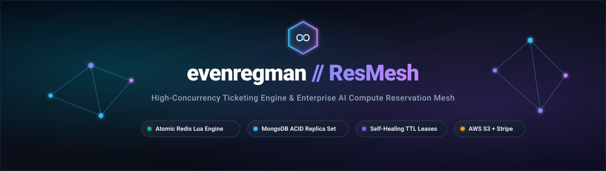
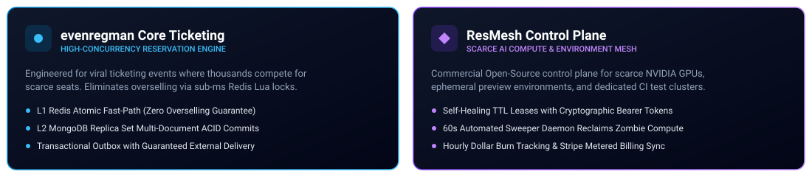
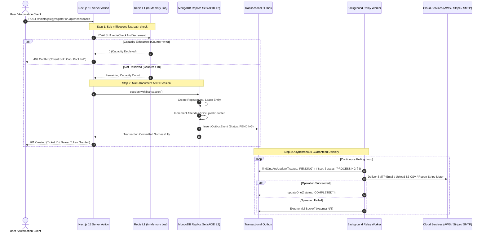

<p align="center">
  
</p>

<p align="center">
  <a href="https://nextjs.org/"></a>
  <a href="https://react.dev/"></a>
  <a href="https://www.mongodb.com/"></a>
  <a href="https://redis.io/"></a>
  <a href="https://aws.amazon.com/s3/"></a>
  <a href="https://stripe.com/"></a>
  <a href="https://opentelemetry.io/"></a>
</p>

<p align="center">
  <strong>An enterprise-grade, high-throughput dual-engine distributed platform.</strong><br>
  Built on Next.js 15 App Router, Redis Lua in-memory fast-path locking, MongoDB Replica Set ACID transactions, and a Transactional Outbox relay.
</p>

<p align="center">
  <a href="#-dual-engine-architecture">Dual Engines</a> •
  <a href="#-why-this-architecture">Architecture Highlights</a> •
  <a href="#-interactive-concurrency-lifecycle">Concurrency Flow</a> •
  <a href="#-complete-documentation-hub">Documentation</a> •
  <a href="#-60-second-quickstart">Quickstart</a> •
  <a href="#-concurrency--load-testing">Load Testing</a>
</p>

---

## 🏛️ Dual-Engine Architecture

<p align="center">
  
</p>

---

## ⚡ Why This Architecture?

Traditional SaaS applications and naive CRUD clones fail catastrophically under burst traffic. Here is how `evenregman // ResMesh` compares against standard implementations:

| Operational Dimension | Standard Web Apps / Naive CRUD | `evenregman // ResMesh` Engine |
|---|---|---|
| **Peak Concurrency** | ❌ Vulnerable to TOCTOU race conditions; database locks oversell seats | ⚡ **Atomic Redis Lua L1 Lock**: Sub-ms in-memory decrement with **zero overselling guarantee** |
| **Data Consistency** | ❌ Dual-write anomalies: external network call succeeds while DB write fails | 🛡️ **Transactional Outbox**: Business mutations & event records commit in the same atomic session |
| **Cloud Environments** | ❌ Zombie environments run indefinitely, hoarding massive cloud bills | ⏳ **Self-Healing TTL Leases**: 60s background sweeper daemon atomically reclaims slots |
| **Enterprise Identity** | ❌ Manual employee account creation and spreadsheet rosters | 🏢 **SCIM v2 Protocol**: Automated directory sync with Okta, Azure AD, CyberArk |
| **S3 Export Storage** | ❌ Synchronous CSV creation blocks the HTTP server thread pool | ☁️ **Async AWS SigV4 Streaming**: Background BullMQ workers with JIT pre-signed download URLs |
| **Revenue & Monetization** | ❌ Static credit card forms with flat subscription tiers | 💳 **Stripe Metered Billing**: Automated usage reporting based on live hourly compute burn rate |

---

## 🔄 Interactive Concurrency Lifecycle

How a reservation request travels from a user click to an atomic commit without database contention:



---

## 📚 Complete Documentation Hub

The project includes an extensive, enterprise-grade documentation suite located in [`docs/`](./docs):

| Guide | Description |
|---|---|
| [**01. System Overview**](./docs/01_SYSTEM_OVERVIEW.md) | Business model, COSS architecture, high-level subsystem breakdown. |
| [**02. Architecture Deep Dive**](./docs/02_ARCHITECTURE_DEEP_DIVE.md) | Concurrency mechanics, Lua scripts, transactional outbox, and CDC projections. |
| [**03. Complete API Reference**](./docs/03_API_REFERENCE.md) | Full route catalog, SCIM v2 specifications, Stripe webhooks, and SSE feeds. |
| [**04. ResMesh Compute Mesh**](./docs/04_RESMESH_COMPUTE_MESH.md) | Infrastructure abstraction, bearer tokens, lease lifecycles, and burn tracking. |
| [**05. Production Deployment**](./docs/05_PRODUCTION_DEPLOYMENT.md) | Kubernetes, multi-target Dockerfile, MongoDB Atlas replica set requirements. |
| [**06. Environment & Security Matrix**](./docs/06_ENV_VARS_AND_SECURITY.md) | Master reference for all 42 configuration options and multi-role RBAC matrices. |
| [**07. SRE Operations & Runbooks**](./docs/07_OPERATIONS_AND_RUNBOOKS.md) | Real-world incident playbooks: Redis restarts, outbox replays, and oplog rollovers. |

---

## ⚡ 60-Second Quickstart

### 1. Start Local Infrastructure
The system requires a MongoDB replica set (`rs0`) and Redis. These are configured out-of-the-box in Docker Compose:
```bash
docker compose up -d rs0 redis
```

### 2. Install & Configure
```bash
pnpm install
cp .env.example .env.local
```

### 3. Launch Development Server
```bash
pnpm dev
```
Visit `http://localhost:3000` for the ticketing portal, or `http://localhost:3000/mesh` for the ResMesh Control Plane.

### 4. Launch Background Daemons
In a dedicated terminal, run the outbox relay, lease reaper, export worker, and CDC pipeline runner:
```bash
pnpm worker
```

---

## 🧪 Concurrency & Load Testing

The repository includes a dedicated standalone high-concurrency load testing harness that simulates hundreds of concurrent reservations hitting the final seats simultaneously:

```bash
pnpm run test:concurrency
```

### Sample Output:
```text
=== STARTING CONCURRENCY STRESS TEST ===
[Event Created] Capacity: 5 seats
[Simulating 50 Concurrent Registrations...]
>> Thread 01: Reserved (4 remaining)
>> Thread 02: Reserved (3 remaining)
>> Thread 03: Reserved (2 remaining)
>> Thread 04: Reserved (1 remaining)
>> Thread 05: Reserved (0 remaining)
>> Thread 06..50: 409 Conflict (Sold Out)
[Assertion Passed] Total Successful Bookings: 5 / 5
[Assertion Passed] Zero Overselling Detected
[Assertion Passed] MongoDB & Redis Counters in 100% Lockstep Synchronization
```

---

## 🛡️ License

This project is licensed under the Apache 2.0 / MIT Dual License - see the [LICENSE](LICENSE) file for details.
