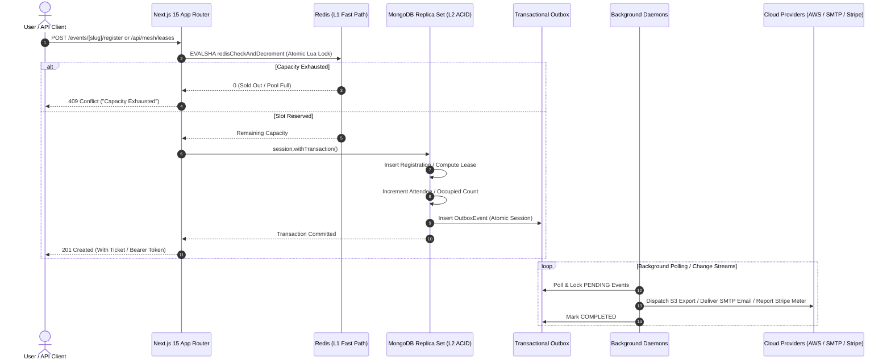

# 🌐 evenregman & ResMesh: Dual-Engine Architecture Documentation

> **Status:** Production-Ready  
> **Framework:** Next.js 15 (React 19 App Router)  
> **Database:** MongoDB (Replica Set required for ACID transactions)  
> **Cache & Lock Layer:** Redis (Lua script concurrency engine)  
> **Cloud Integrations:** AWS S3 (SigV4 Pre-signed URLs), Nodemailer (SMTP), Stripe (Metered Billing), OpenTelemetry  

---

## 1. Executive Summary

This repository hosts a high-throughput, enterprise-grade dual-engine distributed platform:

1. **`evenregman` Core Engine**: A high-concurrency event registration and ticketing system engineered to eliminate overbooking, race conditions, and overselling under burst traffic.
2. **`ResMesh` Control Plane**: An Enterprise AI compute, GPU cluster, and staging environment reservation mesh (built on the Commercial Open-Source / COSS pattern). It provisions scarce cloud infrastructure with self-healing time-to-live (TTL) expiring leases, hourly burn rate metering, and Stripe-metered billing.

---

## 2. Business & Monetization Architecture

The system implements the **Supabase / Temporal / PostHog B2B Open-Core Model**:

```mermaid
graph TD
    subgraph Community Open Source
        Core[evenregman Core Ticketing]
        MeshOSS[ResMesh Local Compute Slots]
        MongoTx[MongoDB ACID Transactions]
        RedisL1[Redis L1 Lua Atomic Reservations]
    end

    subgraph Enterprise B2B SaaS
        SSO[Enterprise SSO / SAML / OIDC]
        SCIM[SCIM v2 Automated Provisioning]
        StripeSync[Stripe Metered Usage & Invoicing]
        AuditSSE[Real-time Audit Logs SSE Feed]
        CDC[Change Data Capture Analytics Projections]
    end

    Community Open Source -->|Upgrades to| Enterprise B2B SaaS
```

---

## 3. High-Level System Architecture



---

## 4. Subsystem Catalog

| Subsystem | Primary Location | Key Capabilities |
|---|---|---|
| **Atomic Concurrency Engine** | `src/lib/redis-operations.ts`<br>`src/lib/registrations.ts` | Sub-millisecond Lua capacity check & decrement, pessimistic MongoDB ACID rollback, zero-overselling guarantee. |
| **ResMesh Compute Mesh** | `src/lib/mesh/`<br>`src/app/(mesh)/` | Time-decaying leases, cryptographic bearer tokens (`rmsh_...`), 60s background sweeper daemon, utilization metrics. |
| **Transactional Outbox** | `src/lib/outbox.ts`<br>`src/workers/outbox-relay.ts` | Eliminates dual-write anomalies; publishes events in same DB transaction; exponential backoff retry worker. |
| **AWS S3 Export Pipeline** | `src/lib/s3.ts`<br>`src/jobs/export-worker.ts` | Background CSV aggregation streaming, AWS SDK v3 uploads, SigV4 cryptographic pre-signed URLs with JIT refresh. |
| **Transactional Email** | `src/lib/email.ts`<br>`src/workers/event-handlers/` | Asynchronous branded HTML booking receipts and cancellation notices via Nodemailer SMTP. |
| **Stripe Metered Billing** | `src/lib/billing/`<br>`src/app/api/webhooks/stripe/` | Hourly compute burn rate metering, Stripe meter event reporting, HMAC-verified webhook subscription sync. |
| **Enterprise SCIM v2** | `src/app/api/scim/v2/[...scim]/` | Identity directory sync for Okta, Azure AD, and CyberArk; Next.js 15 async promise resolution compliant. |
| **Change Data Capture (CDC)** | `src/workers/cdc-worker.ts`<br>`src/lib/cdc-projection.ts` | MongoDB Change Streams watching mutations to maintain pre-aggregated time-series analytics with auto resume-token reset. |

---

## 5. Master Documentation Index

Comprehensive guides, specifications, and runbooks are available in the [`docs/`](./docs) directory:

1. [**Architecture Deep Dive**](./docs/02_ARCHITECTURE_DEEP_DIVE.md): Detailed mechanics of distributed locking, outbox patterns, and CDC pipelines.
2. [**Complete API Reference**](./docs/03_API_REFERENCE.md): Full REST API, SCIM v2, SSE audit streaming, and Stripe webhook catalog.
3. [**ResMesh Compute & Environment Mesh**](./docs/04_RESMESH_COMPUTE_MESH.md): Mechanics of scarce resource reservations, token lifecycles, and self-healing sweepers.
4. [**Production Deployment Guide**](./docs/05_PRODUCTION_DEPLOYMENT.md): Kubernetes, Docker Compose, MongoDB Atlas replica set requirements, and container scaling.
5. [**Environment Variables & Security Specification**](./docs/06_ENV_VARS_AND_SECURITY.md): Master matrix of all 42 environment variables and multi-role RBAC matrices.
6. [**Operations & Incident Runbooks**](./docs/07_OPERATIONS_AND_RUNBOOKS.md): Real-world SRE playbooks for Redis restarts, poison pill outbox events, and oplog rollovers.

---

## 6. Local Quickstart (Development)

### Prerequisites
* Node.js 20+ / pnpm 10+
* Docker & Docker Compose (required for local MongoDB Replica Set `rs0` and Redis)

### Running Locally
```bash
# 1. Start local MongoDB Replica Set (rs0) and Redis
docker compose up -d rs0 redis

# 2. Install dependencies
pnpm install

# 3. Initialize environment variables
cp .env.example .env.local

# 4. Start the Next.js development server
pnpm dev

# 5. In a separate terminal, start the background workers (Outbox, Lease Reaper, Export Worker)
pnpm worker
```

The web application will be accessible at `http://localhost:3000`.  
The ResMesh control plane is available at `http://localhost:3000/mesh`.

