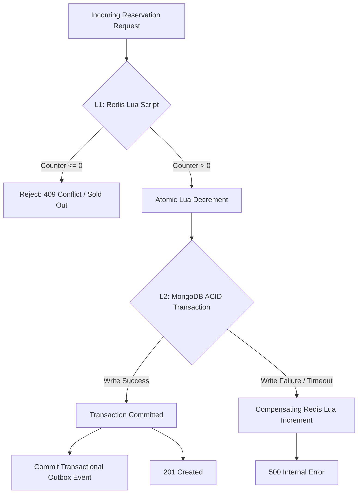
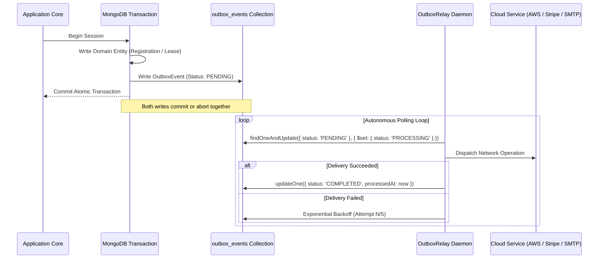
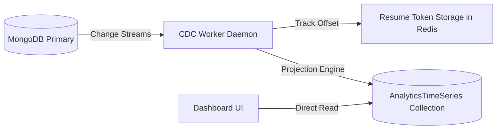

# 🔬 Architecture Deep Dive: Distributed Mechanics & Guarantees

This document outlines the distributed mechanics, concurrency safety guarantees, and transactional workflows implemented across `evenregman` and `ResMesh`.

---

## 1. Concurrency Control & The Two-Tier Reservation Fast Path

Standard relational and document databases suffer from **Time-of-Check to Time-of-Use (TOCTOU)** race conditions when thousands of users attempt to book the final remaining seats or compute slots concurrently.

### The Problem with Simple Database Checks
```sql
-- VULNERABLE: Multiple concurrent threads read count = 99 before any commit
SELECT attendeeCount, capacity FROM events WHERE id = 'xyz';
IF attendeeCount < capacity THEN
    INSERT INTO registrations ...;
    UPDATE events SET attendeeCount = attendeeCount + 1 ...;
END IF;
```

### The Two-Tier Solution Implemented in `evenregman`



### 1.1 Tier 1: Redis In-Memory Lua Atomic Lock
* **Script Location**: `src/lib/redis-lua-scripts.ts` (`CHECK_AND_DECREMENT_SCRIPT`)
* **Execution**: Evaluated atomically on the single-threaded Redis event loop via `EVALSHA`.
* **Behavior**:
  1. Reads key `event:{eventId}:capacity`.
  2. If the key does not exist, queries MongoDB and initializes the counter.
  3. If counter $> 0$, decrements by 1, sets a 7-day sliding TTL (preventing RAM leaks), and returns remaining seats.
  4. If counter $\le 0$, immediately rejects the reservation without placing any read or write load on MongoDB.

### 1.2 Tier 2: MongoDB Replica Set Multi-Document Transaction
* If Redis grants the slot, the application opens a multi-document session:
  ```typescript
  const session = await mongoose.startSession();
  await session.withTransaction(async () => {
    // 1. Create Registration document
    // 2. Increment Event.attendeeCount
    // 3. If attendeeCount == capacity, set status: "FULL"
    // 4. Insert OutboxEvent in the same atomic transaction
  });
  ```
* If MongoDB fails or crashes mid-transaction, a compensating `redisIncrementCapacity` command restores the Redis counter.

---

## 2. Dual-Write Elimination via Transactional Outbox

When a database write must trigger an external action (e.g. sending an email, writing to AWS S3, or updating an external webhook), updating the database and directly calling the network service creates a fatal distributed dual-write bug:

```
Scenario A: DB write succeeds -> Network API times out -> Database thinks it succeeded, external service never notified.
Scenario B: Network API called -> DB transaction fails to commit -> User charged or emailed for a reservation they never got.
```

### The Transactional Outbox Pattern



### Key Reliability Features:
* **Atomic State Claiming**: `findOneAndUpdate` with `{ status: "PENDING" }` to `{ status: "PROCESSING" }` prevents multiple worker instances from processing the same event simultaneously.
* **Exponential Backoff**: Failed events retry with $\min(2^{\text{attempt}} \times 1000\text{ms}, 300000\text{ms})$.
* **Poison-Pill Isolation**: Events exceeding `maxRetries` (default: 5) transition to `FAILED` with the exact stack trace recorded for SRE inspection.

---

## 3. Real-Time Change Data Capture (CDC) Pipeline

For high-throughput dashboards, running real-time aggregation queries (`$lookup`, `$facet`, `$unwind`) directly on primary collections introduces significant database latency.



### 3.1 MongoDB Change Streams
The `CDCWorker` (`src/workers/cdc-worker.ts`) listens to real-time mutations on `registrations` using MongoDB's underlying replication oplog.

### 3.2 Automated Resume Token Recovery
* The worker stores the latest resume token (`_data` cursor offset) in Redis.
* **Oplog Rollover Self-Healing**: If the worker is offline longer than the MongoDB oplog retention window, MongoDB throws error `286` (`ChangeStreamHistoryLost`). The worker automatically catches this error, purges the invalid resume token, and initiates a fresh change stream from the current timeline without crashing the process.

---

## 4. Multi-Tier Caching Architecture (L1 Memory + L2 Redis)

| Tier | Technology | Target | TTL | Invalidation Strategy |
|---|---|---|---|---|
| **L1 HTTP** | Next.js Cache | Rendered React Server Components | Tag-based | `revalidateTag('event:{slug}')` |
| **L2 Distributed** | Redis Hashes / Strings | JSON event metadata & attendee rosters | 3600s | `revalidateEventCache(slug)` |
| **L3 Database** | MongoDB Replica Set | Source of Truth | Persistent | ACID Commits |

When an event is modified, cancelled, or sold out:
1. Redis atomic counter is updated.
2. MongoDB document is persisted.
3. `revalidateEventCache(slug)` executes:
   - Deletes `cache:event:${slug}` in Redis.
   - Triggers `revalidateTag("event:${slug}")` in Next.js.
   - Clears Next.js stale static server cache on `/events` and `/events/${slug}`.

