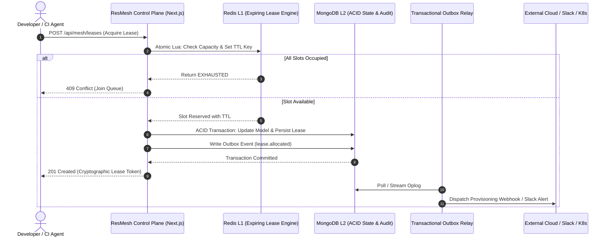

# ResMesh: Enterprise AI & Scarce Resource Reservation Mesh

ResMesh is a deterministic, high-concurrency reservation mesh and control plane designed to manage scarce, high-value infrastructure assets (such as 8x H100 GPU clusters, dedicated AI fine-tuning environments, preview testbeds, and physical hardware benches).

It operates on top of the battle-tested distributed engine of `evenregman`, transforming it into an enterprise platform that eliminates zombie compute, prevents double-booking, and enforces zero-overbooking guarantees.

---

## 1. The Core Distributed Architecture

ResMesh leverages a **Two-Tier Reservation and Lease Engine**:



---

## 2. Key Capabilities

### A. Self-Healing Expiring Leases
* Unlike naive counter decrements, leases in ResMesh are backed by **expiring Redis TTL leases (`src/lib/mesh/lease-redis.ts`)**.
* If a developer reserves a cluster for 2 hours and abandons it, the slot automatically expires and returns to the pool, preventing thousands of dollars in idle cloud waste.

### B. Two-Tier Concurrency Isolation
* **L1 Redis Atomic Layer**: Intercepts high-velocity parallel requests from developers and CI/CD pipelines, deflecting race conditions before they hit database thread pools.
* **L2 MongoDB ACID Layer**: Commits leases inside atomic sessions with optimistic locking on concurrency counts.

### C. Automated Lease Reaper (`src/lib/mesh/lease-reaper.ts`)
* A background sweeping routine identifies expired leases, updates their lifecycle status to `EXPIRED`, and re-opens capacity.

### D. Zero-Overbooking & Zero Double-Booking
* Strict mathematical guarantees that no GPU node or preview box can ever be concurrently allocated beyond its defined slot limit.

---

## 3. API Reference

### 1. List Available Fleets
```http
GET /api/mesh/resources
```
Returns all active GPU nodes, preview stacks, and test environments along with capacity, status, and hourly cost rates.

### 2. Acquire a Lease
```http
POST /api/mesh/leases
Content-Type: application/json

{
  "resourceSlug": "h100-fine-tune-cluster-alpha",
  "durationMinutes": 120
}
```

### 3. Release or Extend Lease
```http
PATCH /api/mesh/leases
Content-Type: application/json

{
  "leaseId": "65b...",
  "action": "extend", // or "release"
  "additionalMinutes": 60
}
```

---

## 4. UI Control Plane

The ResMesh developer console is accessible at:
* `/mesh` - Overview dashboard showing cluster fleet utilization, active lease count, and real-time hourly burn rate.
* `/mesh/resources` - Fleet catalog and specification cards.
* `/mesh/resources/[resourceSlug]` - Interactive 1-click lease booking form with custom duration sliders.
* `/mesh/leases` - Live lease monitor with countdown timers, +60m lease extensions, and early release controls.

